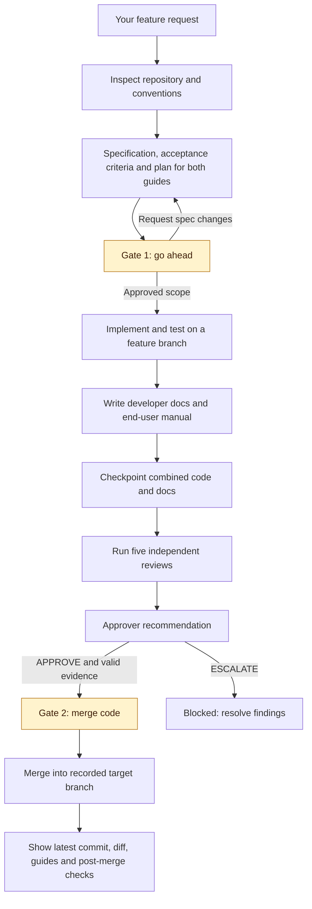
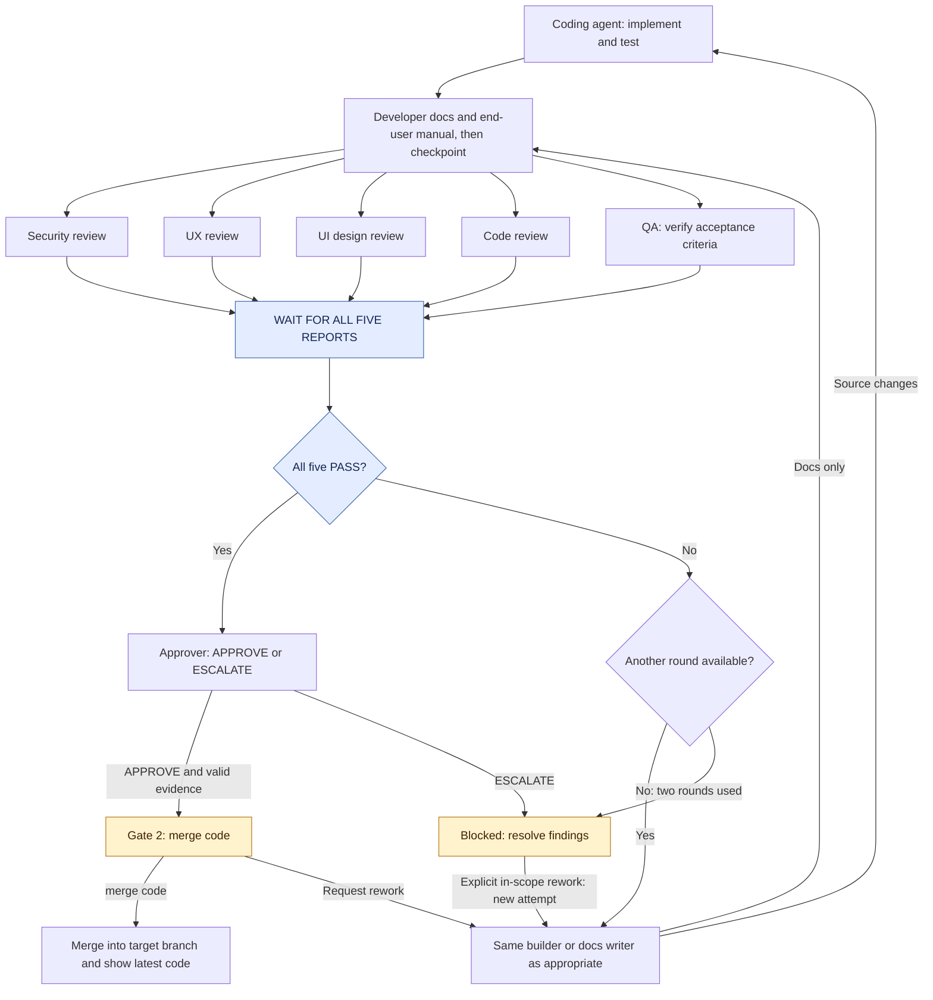
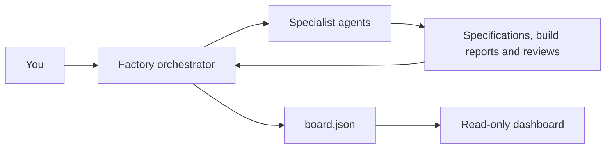
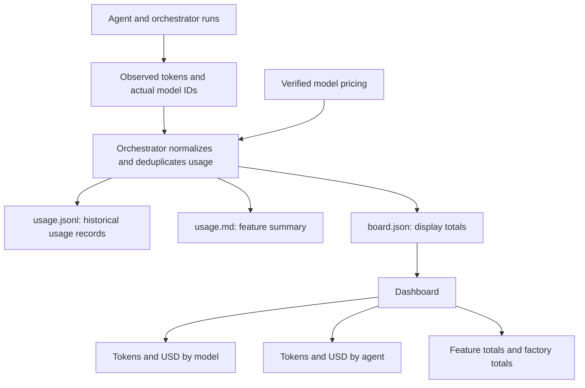

# Software Factory

A reusable generation prompt for building a small, visual software factory in your own project using Claude Code or local Codex.

## What it generates

- An orchestrator skill and specialist agents.
- A coding agent and independent security, UX, UI, code, and QA reviews.
- A Sonnet documentation writer maintaining developer documentation and an end-user manual.
- A dashboard showing features, review results, and human approval states.
- Token usage and USD cost breakdowns by model, agent, and feature.
- Markdown specifications, build reports, reviews, and decisions.

## Get started

1. Open [the generation prompt](../GENERATION.md).
2. Copy its complete contents.
3. Open your target project in local Codex or Claude Code.
4. Paste the prompt and let the agent inspect your project and create the files.
5. Follow the generated `factory/README.md` to start the dashboard and run your first feature.

Use your own AI provider account.

## Ten agent roles

| Role | Claude Code model |
| --- | --- |
| Orchestrator | Current owning session's configured model |
| Spec writer | Opus |
| Builder | Opus |
| Documentation writer | Sonnet |
| Security reviewer | Opus |
| UX reviewer | Sonnet |
| UI reviewer | Sonnet |
| Code reviewer | Sonnet |
| QA reviewer | Sonnet |
| Approver | Opus |

There is one orchestrator and nine specialists. Verify supported exact model identifiers and actual execution during setup. Local Codex support inherits configured Codex models rather than claiming to run Claude models.

## Developer documentation and end-user manual

Before implementation, the spec writer freezes a documentation_plan in spec.md and spec-contract.json. It defines two required deliverables, developer_documentation and end_user_manual, each with an audience, entry page, assigned pages/write paths, required coverage, baseline gaps, feature impact and verification steps.

| Deliverable | Required coverage |
| --- | --- |
| Developer documentation | Product purpose/features, architecture/data flow, source/module map and decisions, data model, auth/integrations, reproducible setup, safe configuration, conventions, exact test/lint/build commands, APIs where implemented, maintenance, technical troubleshooting and limitations. It should let another developer understand, run and maintain the app. |
| End-user manual | Access/onboarding, users/roles, navigation, step-by-step supported tasks with prerequisites, actual labels or commands, expected results and error recovery, relevant admin tasks/settings, FAQ, troubleshooting, limitations and available help. Use plain language and verified examples or screenshots where available. |

After the implementation commit, the Sonnet documentation writer updates both guides on the same feature branch while the builder is idle. Preserve existing docs conventions and locations; otherwise use docs/developer/README.md and docs/user-manual/README.md as entry pages with further pages as needed. Link both from the app README and docs navigation. These paths are generated app outputs, not files shipped in this repository. Reuse shared references without duplication. CLI/API consumers also need a user manual.

Assess agreed baseline gaps in both guides on the first feature; later update affected pages and verify unchanged coverage. Explain individual inapplicable topics; neither guide can be waived. Follow project style, otherwise Diataxis and Google's developer writing/accessibility guidance; record relevant official source versions/dates and unverified limitations. Never invent app capabilities or check results.

The private documentation.md report identifies the implementation and final combined commits, permitted doc-only changes, standards and checks. It records entry pages, coverage, verification evidence/limitations and COMPLETE/CHANGES status separately for both deliverables. Both must be complete and current before overall completion. The report cannot replace the guides.

Check links and coverage, technical onboarding/API accuracy and user steps against actual screens/commands, roles and behavior. Distinguish executed walkthroughs from source-only checks. All five reviewers inspect the final combined commit: Code/QA check technical accuracy, UX/UI check manual usability/accessibility, and security checks safe configuration, permissions and disclosure in both. Missing, incomplete or stale required content in either guide blocks merge approval and merge.

Source rework returns to the SAME builder; documentation findings return to the writer. Reassess both guides, checkpoint and run all five reviews again, including for documentation-only fixes. Writers stay idle during review; no docs are added after merge approval. The dashboard exposes separate guide statuses, reviewed commits and safe entry links, with the writer's report separately labelled. Track documentation runs/revisions in usage.

For an existing factory, have its owner upgrade role routing/loading, contracts, permissions, stage transitions, per-deliverable evidence, accounting, dashboard publication and review/approval gates together. Preserve jobs, sessions and history. Legacy completion alone is insufficient; active frozen contracts need an explicit scope update and fresh validation/reviews without rewriting past approvals.

## Check connections before features

Use the [repository startup guide](../../README.md) to check installation and authentication, then explicitly authorize live checks using your configured models. Verify access and builder continuation from the same runtime and permission environment used by workers. Codex running the generator does not itself run Claude models.

The updated prompt requires bounded checks, actionable sanitized errors, readiness timestamps, and preserved failure history. Manual tests do not update the board; the existing orchestrator publishes fresh readiness and observable usage. See [troubleshooting](../../codex-claude/maintenance/docs/TROUBLESHOOTING.md) when external PowerShell works but factory workers fail.

## Two approvals per feature

The factory pauses for approval at two stages:

| Stage | What you review | What you type |
| --- | --- | --- |
| Specification | Scope, acceptance criteria, both documentation plans, actual target branch, any baseline proposal, permissions and proposed costs/budget policy. Request edits until it is right. | go ahead |
| Merge | Completed work, both guides, validation, five passing reviews, approver recommendation, target branch and full reviewed commit. | merge code |

Type the phrase as your entire message in the owning chat or the generated runner's supported human-interactive session. These phrases are not standalone PowerShell commands. You do not need to type a job ID or commit SHA: the factory internally binds consent to the current displayed job/offer. Viewing evidence or typing a legacy approve command does not authorize implementation or merge.

Between these gates, implementation, documentation, tests and in-scope review fixes run automatically. A changed specification, extra spending or new authorized scope returns to the first gate; routine corrections do not. Host, sandbox and provider tool permissions remain separate and cannot be bypassed by factory consent. Unresolved checks/recovery or exhausted review rounds show a blocker rather than another generic approval prompt; explicit in-scope rework is an instruction to continue that job.

Only APPROVE plus all required valid evidence permits a merge offer; ESCALATE, failed reviews or incomplete docs stay blocked. A changed source/docs/target/evidence invalidates the displayed offer; affected checks/reviews and a fresh merge code are required at the same second gate. Refusal, wrong-stage, quoted, stale or agent-generated messages cannot approve anything. The factory asks once per unchanged offer, including across polling/resume, and consumes each human event once.

After merging into the recorded target branch, show its latest commit, changed files/code diff, both guide links and actual post-merge checks, plus an existing authorized local preview when available. Preserve failures accurately. Merge consent alone does not authorize push or deployment.

Existing generated factories need their owner to migrate gate states, spec/merge receipts, commands, human-input validation and dashboard views together, preserving jobs/sessions/history. Old consent is historical evidence and cannot approve a new offer.

## How a feature moves through the factory

The orchestrator prepares the specification and proposed permissions/costs, pauses for your go ahead, then coordinates implementation through reviews automatically within that scope. Only an eligible completed result reaches the merge code gate. Host/tool permissions remain separate.

The review stage includes a rework loop, shown below.

## Reviews and rework

All five reviewers must finish before revisions begin. Route source findings to the same builder and documentation findings to the writer, with a maximum of two review rounds per attempt. Reassess both guides before the next checkpoint and complete review round.

An agent’s `APPROVE` is a recommendation. Human approval is required, and failed mandatory reviews must be resolved before merging.

## Who controls the files?

The orchestrator is the only writer of `board.json`. Workers write their own reports; the builder also edits application code/tests, and the documentation writer edits only assigned docs on the same feature branch after implementation. Serve only sanitized approved state/reports/docs through safe manifest links; private jobs, source, logs and credentials stay outside the public directory.

The dashboard displays progress. Approval commands run in Claude Code or Codex.

## Token usage and USD costs

Usage is recorded after each agent run, including documentation runs/revisions, observable retries and rework. The dashboard shows totals by agent, actual model, review round, and feature.

Reporting depends on available runtime telemetry:

- **Measured:** token counts reported by the runtime.
- **Estimated:** API-equivalent cost calculated from recorded pricing.
- **Reported charges:** authoritative billing data, when available.
- **Partial or unavailable:** missing usage or pricing information.

Unknown usage is never displayed as zero. Estimated API-equivalent costs are not necessarily additional charges on a subscription.

## Commands after generation

| Action | Claude Code command |
|---|---|
| Start a feature | `/factory <feature>` |
| Run the next backlog item | `/factory next` |
| View evidence/current gate offer | `/factory review <job-id>` |
| Approve the displayed specification | `go ahead` |
| Merge the displayed eligible commit | `merge code` |
| Request changes | `/factory rework <job-id> <note>` |

Type approval phrases as the whole message in the owning chat, optionally with its supported factory skill prefix. Legacy approve commands are evidence-only/deprecated. The generated instructions document the corresponding local Codex invocation without changing its configured models.

## Contributing

Open an issue to suggest improvements, or submit a pull request updating the prompt and documentation.

## License

MIT. See [LICENSE](../../LICENSE).
