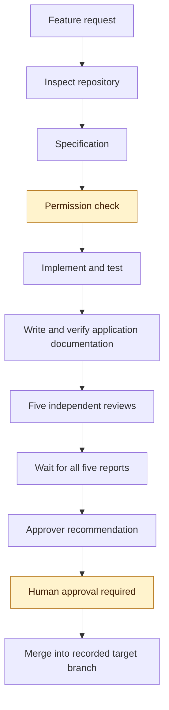
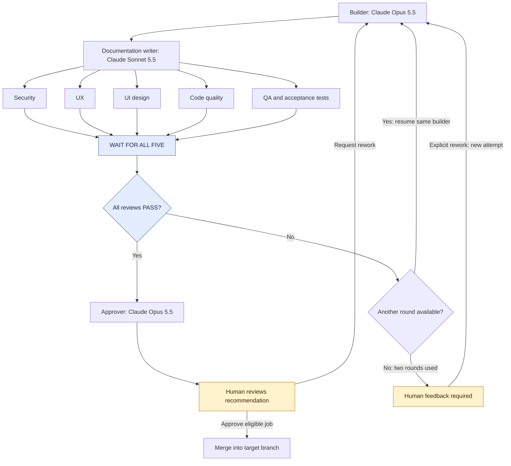
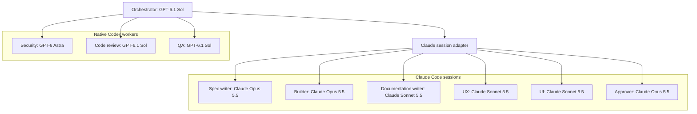
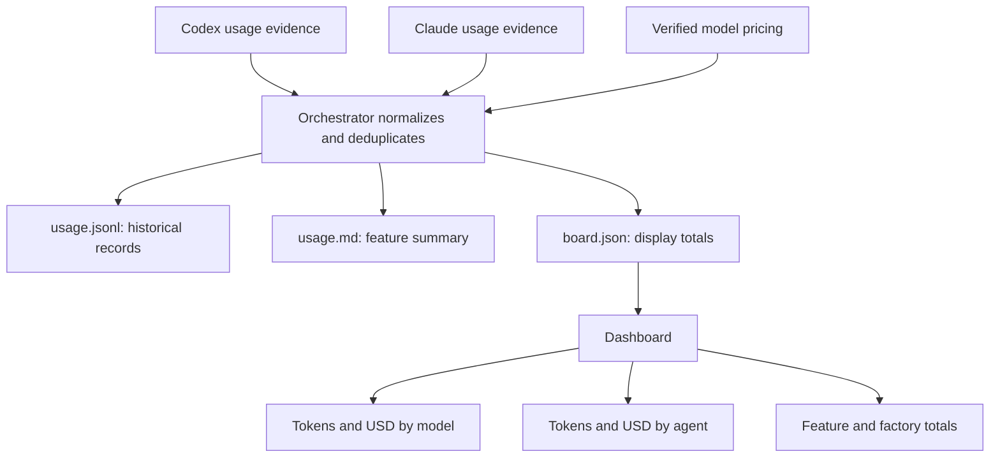

# Software Factory

A reusable generation prompt for building a small, visual software factory using local Codex and Claude Code together.

A GPT-6.1 Sol orchestrator coordinates nine specialist agents. Features move through specification, implementation, documentation, independent reviews, and human approval. One dashboard link opens jobs, reports, documentation and usage, with the latest activity at the top and paginated history.

## Get started

This folder contains a reusable prompt, not an installed factory. Copy [GENERATION.md](../GENERATION.md) into Codex opened in your application project. The prompt is self-contained: the generated factory must include its own helpers, tests and setup instructions.

1. Install a current Node.js LTS, Git, Codex and Claude Code; install Python 3 for the dashboard. Sign in using your own provider accounts.
2. Open the actual application folder in PowerShell, verify the programs, then start Codex with the pinned orchestrator model. See [SETUP.md](SETUP.md) for exact commands and expected results.
3. Paste the complete generation prompt. It inspects the project, generates the factory and runs offline checks before launching workers.
4. Follow the generated readiness checklist. Local installation, live model access, builder resume and full feature validation are separate results. Explicit live checks consume provider usage.
5. In Codex, start a feature with `$factory <feature>`. In Claude Code, `/factory <feature>` forwards to Codex. An existing factory resumes its registered owner.

The generated quick-start commands are:

~~~powershell
node factory/scripts/factory.mjs check
node factory/scripts/factory.mjs validate
node factory/scripts/factory.mjs efficiency
node --test factory/scripts/*.test.mjs
node factory/scripts/factory.mjs prepare-dashboard
~~~

Run these from the generated factory workspace, after generation. They must not dispatch paid model checks. The generated instructions also show the detected Python server command and exact live-check workflow.

## What setup now handles

The prompt includes early native-command and permission checks, Windows executable resolution, nested Git projects, scoped worker input/report access, worktree role loading, exact acceptance commands, timeout recovery, same-session rework, round-two reviewer evidence, and human approval parsing. It keeps current dashboard readiness separate from historical failures and preserves real usage evidence.

[SETUP.md](SETUP.md) is the beginner walkthrough. [TROUBLESHOOTING.md](TROUBLESHOOTING.md) maps known symptoms to recovery steps. Account/model availability and managed computer restrictions can still require human action; the factory must explain those requirements rather than claim success.

## Reduce repeated work and token usage

Read [EFFICIENCY.md](EFFICIENCY.md) for a short feature-request template and the daily workflow. The generated factory must load the full generation prompt only for setup/audit, then dispatch focused role tasks using one current project map and relevant source paths. Workers can still investigate additional in-scope evidence.

The policy requires concise reports, bounded inline logs with complete private evidence, deduplicated fresh access checks, zero automatic outer diagnostic retries by default, and configurable job/stage budgets. Required acceptance, QA independence and all five reviews remain intact. The local efficiency operation and dashboard expose actual usage, retries, durations and budget completeness without another model call.

Future installations can reuse a trusted versioned starter exported from a validated generated factory, with integrity checks and conflict-aware installation. This prompt package does not ship a complete prebuilt runtime. Existing factories receive focused upgrades rather than regeneration. Token/cost savings must be measured; shorter input and session reuse alone do not prove them.

## Check connections before features

Local checks do not prove account access to a model. After generation, ask the owning Codex orchestrator to check one unique Claude model at a time through the actual adapter, then verify the SAME recorded diagnostic builder session can resume. Preserve failed invocation history and record real usage.

An external PowerShell success does not prove a Codex child process can connect. A direct adapter test does not update the dashboard; the owner must publish a fresh check with its timestamp and execution environment.

The optional checker in the [maintainer reference](../maintenance/docs/REPOSITORY-GUIDE.md) can help diagnose connections. It belongs to the prompt repository, not to a newly generated application. The pasted prompt must generate equivalent checks without requiring that repository to be present.

## Requirements

- A current Node.js LTS, Git, local Codex and Claude Code.
- Python 3 available as `python` or `py` for the dashboard server.
- Your own accounts with access to the four exact assigned models.
- A selected application Git repository and a reviewed clean committed base before feature workers run. A remote is optional for local work.
- Effective host and provider permissions for the required file, process, network and local test operations.

Preserve existing application files and account settings. Configure only the access actually needed by the job.

## Ten agent roles

**One orchestrator and nine specialist agents:**

| # | Agent | Model | Responsibility |
|---|---|---|---|
| 1 | Orchestrator | GPT-6.1 Sol | Coordinates workers and maintains factory state |
| 2 | Spec writer | Claude Opus 5.5 | Defines scope and acceptance criteria |
| 3 | Builder | Claude Opus 5.5 | Implements, tests, and revises code |
| 4 | Security reviewer | GPT-6 Astra | Checks security risks |
| 5 | UX reviewer | Claude Sonnet 5.5 | Checks usability and user flows |
| 6 | UI reviewer | Claude Sonnet 5.5 | Checks visual design and accessibility |
| 7 | Code reviewer | GPT-6.1 Sol | Checks correctness and maintainability |
| 8 | QA reviewer | GPT-6.1 Sol | Independently verifies tests and acceptance criteria |
| 9 | Documentation writer | Claude Sonnet 5.5 | Writes and maintains professional application documentation after implementation |
| 10 | Approver | Claude Opus 5.5 | Recommends approval or escalation |

The human provides the final approval before merging.

## Professional application documentation

The new documentation writer runs after implementation and before all five independent reviews. It reads the actual code, tests and accepted specification, then updates the app's existing README and documentation. On the first feature it assesses baseline coverage; later features refresh affected content.

Its scope includes getting started, user/admin task guides, architecture, configuration, developer/test instructions, API reference where relevant, and troubleshooting. It preserves existing conventions and avoids invented capabilities, secrets and unverified deployment instructions.

The authoring policy uses [Diataxis](https://diataxis.fr/start-here/) for documentation structure and [Google's developer style guidance](https://developers.google.com/style) for writing. For HTTP API schemas, it checks the current [OpenAPI specification](https://spec.openapis.org/oas/latest.html) and uses a published version compatible with the app's tools. The writer records reference dates and versions rather than claiming universal latest-standard compliance.

Documentation changes are committed on the feature branch before checkpointing. The five reviewers check the combined code-and-documentation commit. Missing or outdated required docs block approval. Documentation updates after rework get a new checkpoint and complete review round; nothing is appended after human approval.

## Feature workflow

The orchestrator inspects the repository before workers start. Additional permission is requested before implementation when necessary.



Requested changes follow the rework loop below.

## Reviews and rework

The documentation writer finishes before the review checkpoint. The builder and documentation writer remain idle while reviewers check the same committed result. Every review must finish before revisions begin.



Each attempt allows two review rounds. Explicit human rework begins another attempt and preserves previous reports. Source revisions refresh affected documentation before the next checkpoint; documentation-only corrections also require a fresh complete review round.

Failed mandatory reviews must be resolved before merging. An agent’s `APPROVE` is a recommendation, not human authorization.

## How Codex and Claude work together

Codex coordinates the factory. A provider adapter launches Claude workers and resumes the original Claude builder session for revisions.



Every invocation records its requested and actual model. Model mismatches and unavailable models must be surfaced rather than silently substituted.

## Token usage and costs

The factory records observable usage after each agent invocation, including documentation runs, retries, reviews, and builder revisions.



The dashboard distinguishes:

| Status | Meaning |
|---|---|
| Measured usage | Token counts reported by the runtime |
| Estimated cost | API-equivalent cost calculated from recorded rates |
| Reported charges | Authoritative billing data, when available |
| Partial or unavailable | Missing telemetry, pricing, or billing information |

Unknown usage is never treated as zero. Subscription usage does not necessarily create an additional dollar charge.

Historical records retain the pricing used when their cost was calculated.

## One dashboard link for everything

After generation, prepare the sanitized public folder from the factory workspace:

~~~powershell
node factory/scripts/factory.mjs prepare-dashboard
python -m http.server 8765 --bind 127.0.0.1 --directory factory/.local/public
~~~

Use `py -3` instead of `python` if that is the detected Python 3 command. Keep that terminal open and open one link: **http://127.0.0.1:8765/**. If the port is occupied, select another free port and use that port in the link. The legacy /dashboard.html entry remains compatible.

The same application provides navigation to Overview, Jobs, Activity, Documentation, Usage and Readiness. Open a job to view its specification, build report, documentation report, review rounds, approval and usage without leaving the dashboard. Internal links support refresh and browser Back/Forward.

**Latest activity appears at the top**, newest first. These transactions are factory invocations, usage records and labelled workflow events. They show time, job, role/action, model, status and token/cost evidence where available. They do not represent business orders or actual provider charges.

Latest activity, the full Activity view and Jobs have pagination: **10 items by default**, with selectable limits of **10, 25, 50 or 100**. Controls show the current range/count and Previous/Next. Filters apply across the selected history before pagination. Global totals stay independent of the page size. New activity does not silently shift an older page while you read it.

The generated publisher must provide bounded sanitized chunks and counts instead of downloading the entire growing history on every poll. Jobs and reports load when opened. Current readiness remains separate from historical failures, and unknown usage stays unavailable.

Serve only the prepared public folder. The empty publishable starter board is not live state. The HTTP server serves saved state; it does not start models or publish readiness. See [troubleshooting](TROUBLESHOOTING.md) for stale views, missing routes and pagination issues.

Only the orchestrator publishes state. The dashboard is read-only; viewing approval evidence does not merge anything. Approval still uses the verified factory commands.

## Factory operations

| Operation | Purpose |
|---|---|
| `factory <feature>` | Start a feature |
| `factory next` | Run the next backlog item |
| `factory approve <job-id>` | Open evidence for human review; no merge |
| `factory approve <job-id> --commit <full-reviewed-SHA>` | Authorize only that eligible reviewed commit |
| `factory rework <job-id> <note>` | Resume the builder with feedback |

The generated instructions explain the supported Codex invocation and Claude Code `/factory` launcher.

## Files

Before generation, this edition contains:

```text
README.md
GENERATION.md
docs/
  GUIDE.md
  SETUP.md
  TROUBLESHOOTING.md
  EFFICIENCY.md
maintenance/
```

After generation, the project also contains:

```text
.agents/skills/factory/   # Codex orchestrator skill
.codex/agents/           # Native Codex reviewers
.claude/                 # Claude launcher and worker definitions
  agents/documentation-writer.md
factory/
  project.json           # optional nested application selection
  models.json
  pricing.json
  efficiency.json
  board.json
  usage.jsonl
  dashboard.html         # published as index.html and dashboard.html
  backlog.md
  repo-context.md
  README.md
  SETUP.md
  TROUBLESHOOTING.md
  VALIDATION.md
  EFFICIENCY.md
  scripts/
  .local/                # ignored private state and sanitized public projection
  .worktrees/            # ignored feature worktrees
  jobs/
```

## Contributing

Open an issue to suggest improvements or submit a pull request updating the prompt and documentation.

## License

MIT. See [LICENSE](../../LICENSE).
