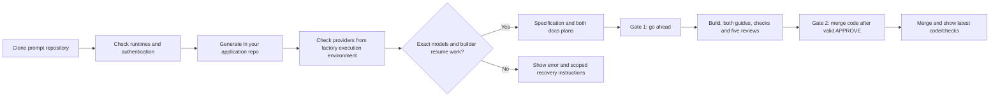

# Repository connection and validation reference

Shared maintainer reference. Commands below run from the prompt repository root. New users should start at the [edition chooser](../../../README.md); this material is optional for following an edition's generation prompt.

Generation prompts for a small software factory with two approval gates: specify a feature and both documentation plans, wait for the human's go ahead, build it, write developer documentation and an end-user manual, complete five independent reviews of the combined commit, then wait for merge code on the displayed eligible result. All three editions define ten roles. The factory binds that phrase to the commit internally and shows the latest merged branch/commit, code diff and post-merge checks. The dashboard shows progress, both approval states, separate guide completion/links, observed tokens, and estimated USD costs. Routine in-scope work needs no further factory approval; host/tool permissions remain separate.

This repository contains prompts and a connection checker. **Cloning it does not install or start a generated factory.** Generate one in your own application repository.

| Edition | Generation prompt | Guide |
| --- | --- | --- |
| Codex + Claude | [GENERATION.md](../../GENERATION.md) | [README](../../docs/GUIDE.md) |
| Claude Code | [GENERATION.md](../../../claude-only/GENERATION.md) | [README](../../../claude-only/docs/GUIDE.md) |
| Budget providers | [GENERATION.md](../../../low-cost/GENERATION.md) | [README](../../../low-cost/docs/GUIDE.md) |



## Start on Windows

```powershell
git clone https://github.com/faiqfarooq/software-factory.git
Set-Location -LiteralPath '.\software-factory'
node codex-claude/maintenance/scripts/check-claude.mjs
```

For the Claude editions, install Git, a current Node.js LTS, Claude Code, and Python for the generated dashboard server. The hybrid edition also needs Codex. Use your own accounts and verify access to the assigned models. The budget edition needs its configured provider credentials rather than Claude.

Copy your edition's full generation prompt into the coding assistant opened in your **application repository**. Follow the generated instructions. Additional permissions may be needed for child processes, provider connections, or application writes; allow the specific operation when required.

## Check a Claude connection

The default checker only checks local installation and authentication; it makes no model request. An explicitly requested live check consumes provider usage:

```powershell
node codex-claude/maintenance/scripts/check-claude.mjs --live --model claude-opus-5-5
node codex-claude/maintenance/scripts/check-claude.mjs --live --model claude-sonnet-5-5
```

After generation, test the **actual adapter** from the same working directory and execution environment as the factory:

```powershell
# Replace this example path with your generated application's path.
node codex-claude/maintenance/scripts/check-claude.mjs --live --adapter 'D:\my-app\factory\scripts\provider.mjs' --cwd 'D:\my-app' --model claude-opus-5-5
```

The adapter mode expects the documented `launchClaude(options)` export; adapt the checker if your generated runtime uses another interface. Run the same check from the factory's approved execution tools as well as normal PowerShell. An external success does not prove the child process has the same network access. The checker returns evidence to the terminal and **never writes the board or ledger**; the orchestrator must collect real usage and publish its own check results.

[Troubleshooting](TROUBLESHOOTING.md) covers blocked Claude workers, stale dashboard state, missing Codex binaries, and Windows sandbox failures. Connection failures cannot be eliminated on every machine; the prompts require early checks and actionable failures instead of claiming success.

## Validate this prompt repository

For an existing generated factory, updating this prompt repository does not modify its runtime. Ask its existing orchestrator to apply the current setup/check requirements in the updated generation prompt. Preserve jobs, usage history, approval evidence, and builder session IDs; rerun authorized checks and publish fresh readiness rather than regenerating over active state.

```powershell
node --test codex-claude/maintenance/scripts/check-claude.test.mjs codex-claude/maintenance/scripts/docs.test.mjs
```

These are offline tests. They do not validate account access, model availability, an application build, or the generated factory end to end.

MIT licensed. See [LICENSE](../../../LICENSE).
