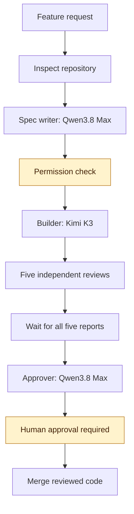
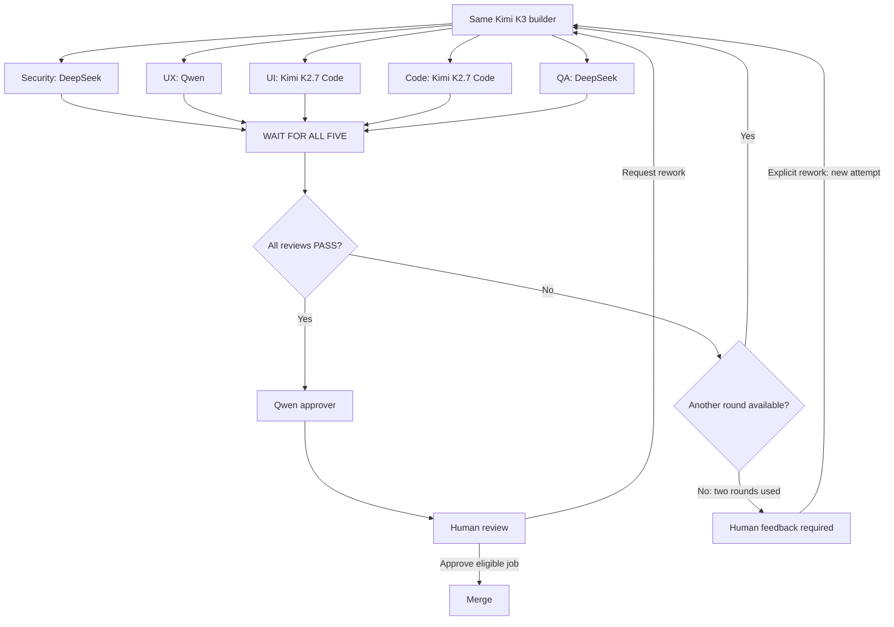
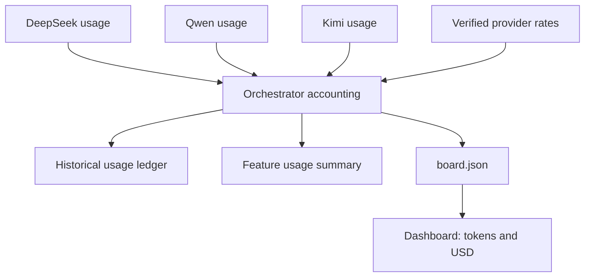

# Software Factory — Budget Edition

A reusable generation prompt for building a visual software factory using DeepSeek, Qwen, and Kimi.

The factory keeps the same core workflow: specification, coding, five independent reviews, and human approval. Its dashboard records progress, tokens, and USD costs.

## Get started

1. Copy the complete contents of [generation.md](generation.md).
2. Open your target project in a coding assistant.
3. Paste the prompt and let it inspect the repository and generate the factory.
4. Follow the generated `factory/README.md` for provider configuration and startup commands.

The coding assistant builds the setup. The generated factory uses DeepSeek V4.1 Flash as its actual orchestrator.

## Nine agent roles

| # | Agent | Model | Responsibility |
|---|---|---|---|
| 1 | Orchestrator | DeepSeek V4.1 Flash | Coordinates workers and maintains factory state |
| 2 | Spec writer | Qwen3.8 Max | Defines scope and acceptance criteria |
| 3 | Builder | Kimi K3 | Implements, tests, and revises code |
| 4 | Security reviewer | DeepSeek V4.1 Flash | Checks security risks |
| 5 | UX reviewer | Qwen3.8 Max | Checks usability and user flows |
| 6 | UI reviewer | Kimi K2.7 Code | Checks visual design and accessibility |
| 7 | Code reviewer | Kimi K2.7 Code | Checks correctness and maintainability |
| 8 | QA reviewer | DeepSeek V4.1 Flash | Independently verifies tests and acceptance criteria |
| 9 | Approver | Qwen3.8 Max | Recommends approval or escalation |

There is one orchestrator and eight workers. The human provides the final merge approval.

## How it works



The DeepSeek orchestrator coordinates every stage. It requests additional permission before implementation when necessary.

## Review and rework loop



All five reports must arrive before revisions start. Each attempt allows two review rounds. Human rework preserves earlier reports and starts a new attempt.

An agent's `APPROVE` is a recommendation. Failed mandatory reviews must be resolved before merging.

## Token and cost tracking



The dashboard shows usage by agent, model, review round, and feature. It distinguishes measured tokens, estimated cost, reported charges, and unavailable data.

Unknown usage is never treated as zero. Historical records retain their original pricing.

## Cost comparison with the original edition

Reference: [original Software Factory](https://github.com/faiqfarooq/software-factory/tree/main/software%20factory).

**Baseline verification:** The linked directory could not be retrieved while preparing this draft. The comparison uses the original nine-role GPT/Claude assignments supplied by the repository owner. Confirm those assignments against the linked edition before describing this as a verified repository comparison.

### Pricing assumptions

Prices below are USD per **1 million uncached input or output tokens**, checked on **October 13, 2026**.

| Model | Input | Output | Pricing basis |
|---|---:|---:|---|
| GPT-6.1 Sol | $2.00 | $10.00 | Standard, short-context API rates |
| GPT-6 Astra | $10.00 | $50.00 | Standard API rates |
| Claude Opus 5.5 | $4.00 | $20.00 | Standard API rates |
| Claude Sonnet 5.5 | $2.00 | $10.00 | Standard API rates |
| DeepSeek V4.1 Flash | $0.30 | $1.20 | Peak rates |
| Qwen3.8 Max | $2.00 | $6.00 | Singapore international endpoint |
| Kimi K3 | $3.00 | $15.00 | Published API input/output rates |
| Kimi K2.7 Code | $0.95 | $4.00 | Standard API rates |

Sources: [GPT-6.1 Sol](https://developers.openai.com/api/docs/models/gpt-6.1-sol), [GPT-6 Astra](https://openai.com/index/gpt-6-astra/), [Claude pricing](https://platform.claude.com/docs/en/models/overview), [DeepSeek pricing](https://api-docs.deepseek.com/quick_start/pricing/), [Qwen pricing](https://www.alibabacloud.com/help/en/model-studio/qwen3-8-max), [Kimi K3 published pricing](https://www.kimi.ai/id/resources/kimi-k3-pricing), and [Kimi K2.7 Code pricing](https://www.kimi.ai/resources/kimi-k2-7-code).

### Equal-token example

Assume each of the nine roles consumes a total of:

- **100,000 uncached input tokens**
- **20,000 billable output tokens**, including reasoning where billed

That is **900,000 input and 180,000 output tokens** across the factory.

This compares input/output token-rate subtotals. It excludes cache reads and writes, tool fees, taxes, subscriptions, promotions, retries, and long-context premiums. It is an illustrative calculation, not a measured feature run or invoice.

| Role | Original model | Budget model | Original subtotal | Budget subtotal |
|---|---|---|---:|---:|
| Orchestrator | GPT-6.1 Sol | DeepSeek V4.1 Flash | $0.400 | $0.054 |
| Spec writer | Claude Opus 5.5 | Qwen3.8 Max | $0.800 | $0.320 |
| Builder | Claude Opus 5.5 | Kimi K3 | $0.800 | $0.600 |
| Security reviewer | GPT-6 Astra | DeepSeek V4.1 Flash | $2.000 | $0.054 |
| UX reviewer | Claude Sonnet 5.5 | Qwen3.8 Max | $0.400 | $0.320 |
| UI reviewer | Claude Sonnet 5.5 | Kimi K2.7 Code | $0.400 | $0.175 |
| Code reviewer | GPT-6.1 Sol | Kimi K2.7 Code | $0.400 | $0.175 |
| QA reviewer | GPT-6.1 Sol | DeepSeek V4.1 Flash | $0.400 | $0.054 |
| Approver | Claude Opus 5.5 | Qwen3.8 Max | $0.800 | $0.320 |
| **Total** | | | **$6.400** | **$2.072** |

**Under these assumptions, the Budget Edition's input/output subtotal is approximately 67.6% lower, saving $4.328 for the illustrated token budget.**

Calculation:

```text
Role subtotal =
  (input tokens / 1,000,000 × input rate)
  + (output tokens / 1,000,000 × output rate)

Savings percentage =
  (original subtotal − budget subtotal)
  / original subtotal × 100
```

DeepSeek's off-peak rates are $0.15 input and $0.60 output per million tokens. Applying those rates to the three DeepSeek roles lowers this example's budget subtotal to **$1.991**, approximately **68.9% below the original subtotal**. [DeepSeek pricing schedule](https://api-docs.deepseek.com/quick_start/pricing/)

### What the comparison does—and does not—show

The calculation shows lower token rates for the stated role mix and workload. It does not establish equivalent quality or the cost of completing a real feature.

Actual savings depend on which roles consume the most tokens, reasoning output, cache charges, provider region, pricing schedules, retries, and review rounds. A builder-heavy workload will produce a different percentage.

For a practical comparison, run both editions against the same acceptance criteria and compare **total cost per successfully accepted feature**, including failed attempts and rework.

API-equivalent estimates should not be interpreted as savings against an existing fixed-price subscription.

## Provider setup

The generated factory requires credentials for:

- DeepSeek.
- Alibaba Cloud Model Studio/Qwen.
- Moonshot/Kimi.

Model IDs are `deepseek-flash`, `qwen3.8-max`, `kimi-k3`, and `kimi-k2.7-code`. Verify the resolved versions and account access before live runs.

Use environment variables or the generated configuration instructions. Keep real keys out of Git and use `.env.example` only for placeholders.

## Dashboard and commands

After generation, start the dashboard from the project root:

```powershell
python -m http.server 8000 --bind 127.0.0.1 --directory factory
```

Open `http://localhost:8000/dashboard.html`.

The generated runner should support:

```powershell
python factory/run.py new "Describe your feature"
python factory/run.py next
python factory/run.py approve <job-id>
python factory/run.py rework <job-id> "Describe the changes"
```

If an existing factory requires a separate profile or directory, follow the generated instructions for its actual command paths.

## Contributing

Open an issue or submit a pull request improving the generation prompt, documentation, provider adapters, or accounting tests.
