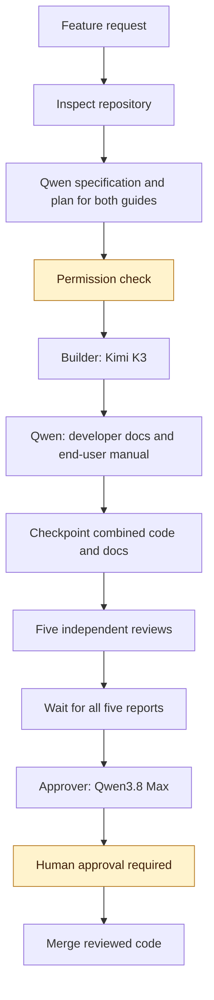
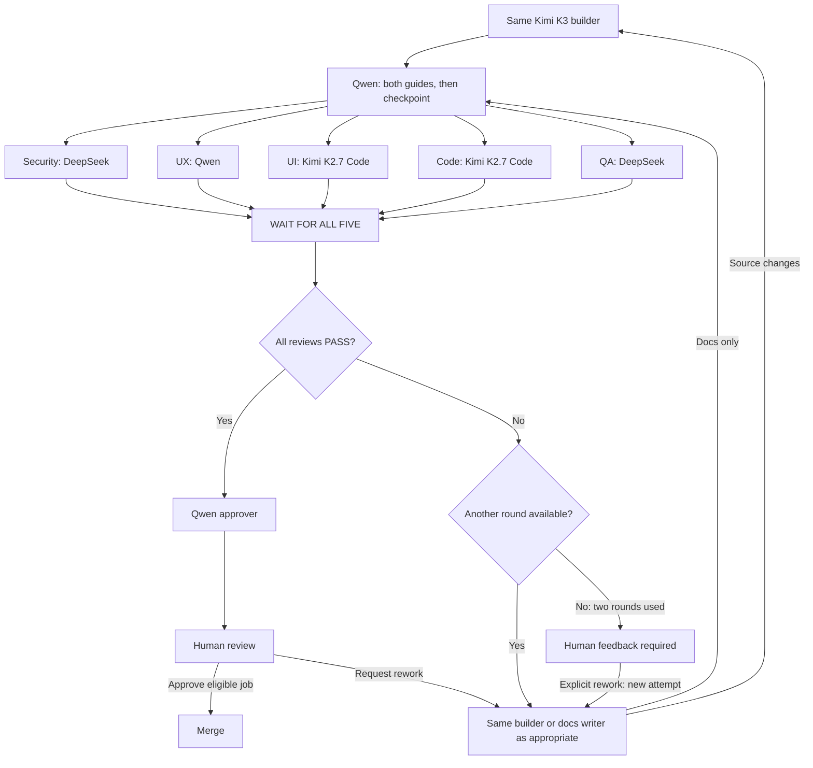
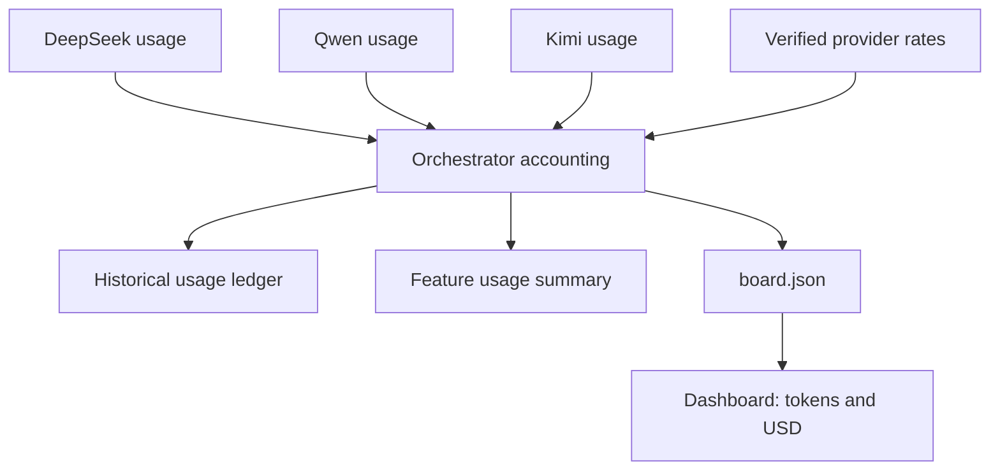

# Software Factory — Budget Edition

A reusable generation prompt for building a visual software factory using DeepSeek, Qwen, and Kimi.

The factory keeps the same core workflow: specification and documentation plan, coding, developer documentation and end-user manual, five independent reviews, and human approval. Its dashboard records progress, guide completion, tokens, and USD costs.

## Get started

1. Copy the complete contents of [GENERATION.md](../GENERATION.md).
2. Open your target project in a coding assistant.
3. Paste the prompt and let it inspect the repository and generate the factory.
4. Follow the generated `factory/README.md` for provider configuration and startup commands.

The coding assistant builds the setup. The generated factory uses DeepSeek V4.1 Flash as its actual orchestrator.

## Check connections before features

The updated prompt requires local configuration checks, explicitly authorized live calls to each configured provider/model, and SAME builder continuation. Run checks from the runner's actual environment; external terminal success alone is insufficient. The Claude checker in the root package is for the Claude editions, not these providers.

Keep current readiness separate from historical invocations, publish timestamps and sanitized reasons, and preserve unavailable usage. See the [startup guide](../../README.md) and [environment/dashboard troubleshooting](../../codex-claude/maintenance/docs/TROUBLESHOOTING.md).

## Ten agent roles

| # | Agent | Model | Responsibility |
|---|---|---|---|
| 1 | Orchestrator | DeepSeek V4.1 Flash | Coordinates workers and maintains factory state |
| 2 | Spec writer | Qwen3.8 Max | Defines scope and acceptance criteria |
| 3 | Builder | Kimi K3 | Implements, tests, and revises code |
| 4 | Security reviewer | DeepSeek V4.1 Flash | Checks security risks |
| 5 | UX reviewer | Qwen3.8 Max | Checks usability and user flows |
| 6 | UI reviewer | Kimi K2.7 Code | Checks visual design and accessibility |
| 7 | Code reviewer | Kimi K2.7 Code | Checks correctness and maintainability |
| 8 | QA reviewer | DeepSeek V4.1 Flash | Independently verifies tests and acceptance criteria |
| 9 | Documentation writer | Qwen3.8 Max | Maintains complete developer documentation and an end-user manual |
| 10 | Approver | Qwen3.8 Max | Recommends approval or escalation |

There is one orchestrator and nine workers. The human provides the final merge approval.

## Developer documentation and end-user manual

Before implementation, the spec writer freezes a documentation_plan in spec.md and spec-contract.json. It defines two required deliverables, developer_documentation and end_user_manual, each with audience, entry page, assigned pages/write paths, required coverage, baseline gaps, feature impact and verification steps.

| Deliverable | Required coverage |
| --- | --- |
| Developer documentation | Product purpose/features, architecture/data flow, source/module map and decisions, data model, auth/integrations, reproducible setup, safe configuration, conventions, exact test/lint/build commands, APIs where implemented, maintenance, technical troubleshooting and limitations. It should let another developer understand, run and maintain the app. |
| End-user manual | Access/onboarding, users/roles, navigation, step-by-step supported tasks with prerequisites, actual labels or commands, expected results and error recovery, relevant admin tasks/settings, FAQ, troubleshooting, limitations and available help. Use plain language and verified examples or screenshots where available. |

After the implementation commit, the Qwen3.8 Max documentation writer runs through the Qwen provider adapter and updates both guides on the same feature branch while the builder is idle. Preserve existing docs conventions and locations; otherwise use docs/developer/README.md and docs/user-manual/README.md as entry pages with further pages as needed. Link both from the app README and docs navigation. These paths are generated app outputs, not files shipped in this repository. Reuse shared references without duplication. CLI/API consumers also need a user manual.

Assess agreed baseline gaps in both guides on the first feature; later update affected pages and verify unchanged coverage. Explain individual inapplicable topics; neither guide can be waived. Follow project style, otherwise Diataxis and Google's developer writing/accessibility guidance; record relevant official source versions/dates and unverified limitations. Never invent app capabilities or check results.

The private documentation.md report identifies implementation and final combined commits, permitted doc-only changes, standards and checks. It records entry pages, coverage, verification evidence/limitations and COMPLETE/CHANGES status separately for both deliverables. Both must be complete and current before overall completion. Verify real writer identity/completion and bind evidence to the commit and spec/contract; a shared Qwen access check is insufficient. The report cannot replace either guide.

Check links and coverage, technical onboarding/API accuracy and user steps against actual screens/commands, roles and behavior. Distinguish executed walkthroughs from source-only checks. All five reviewers inspect the final combined commit: Code/QA check technical accuracy, UX/UI check manual usability/accessibility, and security checks safe configuration, permissions and disclosure in both. Missing, incomplete or stale required content in either guide blocks approval and merge.

Source rework returns to the SAME Kimi builder; documentation findings return to the Qwen writer. Reassess both guides, checkpoint and run all five reviews again, including for documentation-only fixes. Writers stay idle during review; no docs are added after approval. Track documentation runs/revisions separately in usage.

For an existing budget factory, have its owner upgrade role routing/loading, contracts, scoped tools/permissions, stage transitions, per-deliverable evidence, accounting, dashboard publication and review/approval gates together. Preserve jobs, sessions and history. Legacy completion alone is insufficient; active frozen contracts need an explicit scope update and fresh validation/reviews without rewriting past approvals.

## How it works



The DeepSeek orchestrator coordinates every stage. It requests additional permission before implementation when necessary.

## Review and rework loop



All five reports must arrive before revisions start. Source findings return to the same builder and documentation findings to their author. Reassess both guides, checkpoint and run five fresh reviews. Each attempt allows two review rounds. Human rework preserves earlier reports and starts a new attempt.

An agent's `APPROVE` is a recommendation. Failed mandatory reviews must be resolved before merging.

## Token and cost tracking



The dashboard shows usage by agent, model, review round, and feature, including documentation runs/revisions. It distinguishes measured tokens, estimated cost, reported charges, and unavailable data.

Unknown usage is never treated as zero. Historical records retain their original pricing.

## Cost comparison with the original edition

Historical illustrative comparison recorded on 2026-10-13. It uses earlier nine-role hybrid and budget snapshots. Both current generation prompts have ten roles; the preserved example excludes both documentation writers. The figures are not a current-price quote, measured savings or a comparison against either updated edition. Verify provider rates and compare accepted-feature costs before making a purchasing decision.

Reference: [original Software Factory](../../codex-claude/docs/GUIDE.md).

**Baseline verification:** The linked directory could not be retrieved while preparing this draft. The comparison uses the original nine-role GPT/Claude assignments supplied by the repository owner. Confirm those assignments against the linked edition before describing this as a verified repository comparison.

### Pricing assumptions

Prices below are USD per **1 million uncached input or output tokens**, checked on **October 13, 2026**.

| Model | Input | Output | Pricing basis |
|---|---:|---:|---|
| GPT-6.1 Sol | $2.00 | $10.00 | Standard, short-context API rates |
| GPT-6 Astra | $10.00 | $50.00 | Standard API rates |
| Claude Opus 5.5 | $4.00 | $20.00 | Standard API rates |
| Claude Sonnet 5.5 | $2.00 | $10.00 | Standard API rates |
| DeepSeek V4.1 Flash | $0.30 | $1.20 | Peak rates |
| Qwen3.8 Max | $2.00 | $6.00 | Singapore international endpoint |
| Kimi K3 | $3.00 | $15.00 | Published API input/output rates |
| Kimi K2.7 Code | $0.95 | $4.00 | Standard API rates |

Sources: [GPT-6.1 Sol](https://developers.openai.com/api/docs/models/gpt-6.1-sol), [GPT-6 Astra](https://openai.com/index/gpt-6-astra/), [Claude pricing](https://platform.claude.com/docs/en/models/overview), [DeepSeek pricing](https://api-docs.deepseek.com/quick_start/pricing/), [Qwen pricing](https://www.alibabacloud.com/help/en/model-studio/qwen3-8-max), [Kimi K3 published pricing](https://www.kimi.ai/id/resources/kimi-k3-pricing), and [Kimi K2.7 Code pricing](https://www.kimi.ai/resources/kimi-k2-7-code).

### Equal-token example

Assume each of the nine roles consumes a total of:

- **100,000 uncached input tokens**
- **20,000 billable output tokens**, including reasoning where billed

That is **900,000 input and 180,000 output tokens** across the factory.

This compares input/output token-rate subtotals. It excludes cache reads and writes, tool fees, taxes, subscriptions, promotions, retries, and long-context premiums. It is an illustrative calculation, not a measured feature run or invoice.

| Role | Original model | Budget model | Original subtotal | Budget subtotal |
|---|---|---|---:|---:|
| Orchestrator | GPT-6.1 Sol | DeepSeek V4.1 Flash | $0.400 | $0.054 |
| Spec writer | Claude Opus 5.5 | Qwen3.8 Max | $0.800 | $0.320 |
| Builder | Claude Opus 5.5 | Kimi K3 | $0.800 | $0.600 |
| Security reviewer | GPT-6 Astra | DeepSeek V4.1 Flash | $2.000 | $0.054 |
| UX reviewer | Claude Sonnet 5.5 | Qwen3.8 Max | $0.400 | $0.320 |
| UI reviewer | Claude Sonnet 5.5 | Kimi K2.7 Code | $0.400 | $0.175 |
| Code reviewer | GPT-6.1 Sol | Kimi K2.7 Code | $0.400 | $0.175 |
| QA reviewer | GPT-6.1 Sol | DeepSeek V4.1 Flash | $0.400 | $0.054 |
| Approver | Claude Opus 5.5 | Qwen3.8 Max | $0.800 | $0.320 |
| **Total** | | | **$6.400** | **$2.072** |

**Under these assumptions, the Budget Edition's input/output subtotal is approximately 67.6% lower, saving $4.328 for the illustrated token budget.**

Calculation:

```text
Role subtotal =
  (input tokens / 1,000,000 × input rate)
  + (output tokens / 1,000,000 × output rate)

Savings percentage =
  (original subtotal − budget subtotal)
  / original subtotal × 100
```

DeepSeek's off-peak rates are $0.15 input and $0.60 output per million tokens. Applying those rates to the three DeepSeek roles lowers this example's budget subtotal to **$1.991**, approximately **68.9% below the original subtotal**. [DeepSeek pricing schedule](https://api-docs.deepseek.com/quick_start/pricing/)

### What the comparison does—and does not—show

The calculation shows lower token rates for the stated role mix and workload. It does not establish equivalent quality or the cost of completing a real feature.

Actual savings depend on which roles consume the most tokens, reasoning output, cache charges, provider region, pricing schedules, retries, and review rounds. A builder-heavy workload will produce a different percentage.

For a practical comparison, run both editions against the same acceptance criteria and compare **total cost per successfully accepted feature**, including failed attempts and rework.

API-equivalent estimates should not be interpreted as savings against an existing fixed-price subscription.

## Provider setup

The generated factory requires credentials for:

- DeepSeek.
- Alibaba Cloud Model Studio/Qwen.
- Moonshot/Kimi.

Model IDs are `deepseek-flash`, `qwen3.8-max`, `kimi-k3`, and `kimi-k2.7-code`. Verify the resolved versions and account access before live runs.

Use environment variables or the generated configuration instructions. Keep real keys out of Git and use `.env.example` only for placeholders.

## Dashboard and commands

After generation, start the dashboard from the project root:

```powershell
python -m http.server 8000 --bind 127.0.0.1 --directory <generated-public-directory>
```

Replace `<generated-public-directory>` with the directory documented by your generated runner, containing only sanitized state and reports. Open `http://localhost:8000/dashboard.html`; private logs and credentials must stay outside the served directory.

Job details show separate Developer documentation and End-user manual statuses, reviewed commits and safe entry-page links, with the writer's report separately labelled. Publish approved sanitized docs and linked assets/pages through an explicit safe manifest; missing/unapproved items show unavailable. Never expose source, raw logs, credentials or private job/session evidence to make a guide open.

The generated runner should support:

```powershell
python factory/run.py new "Describe your feature"
python factory/run.py next
python factory/run.py approve <job-id>
python factory/run.py rework <job-id> "Describe the changes"
```

If an existing factory requires a separate profile or directory, follow the generated instructions for its actual command paths.

## Contributing

Open an issue or submit a pull request improving the generation prompt, documentation, provider adapters, or accounting tests.
