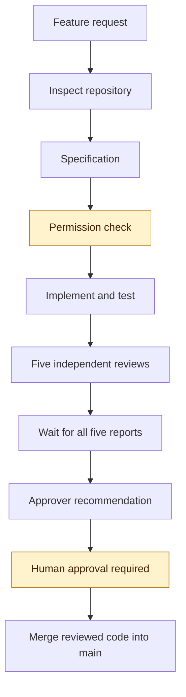
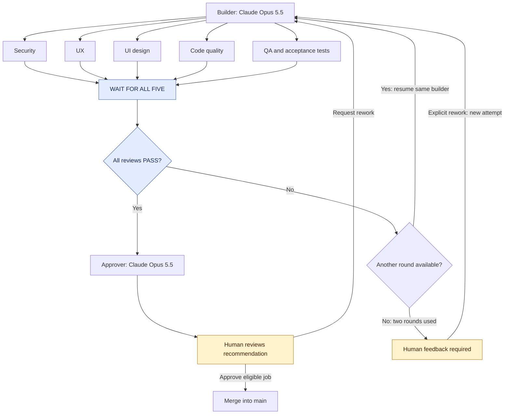
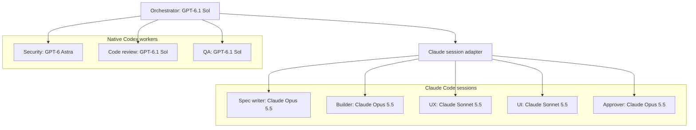
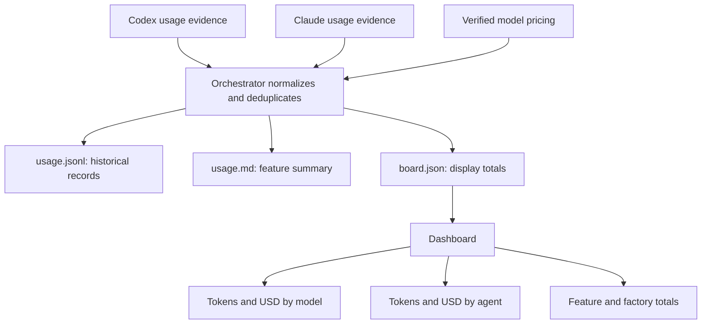

# Software Factory

A reusable generation prompt for building a small, visual software factory using local Codex and Claude Code together.

A GPT-6.1 Sol orchestrator coordinates eight specialist agents. Features move through specification, implementation, independent reviews, and human approval. A dashboard shows progress, token usage, and USD costs.

## Get started

1. Open [the generation prompt](prompts/software-factory.md).
2. Copy its complete contents.
3. Open your target project in local Codex using GPT-6.1 Sol.
4. Paste the prompt.
5. Let Codex inspect the project and generate the factory.
6. Follow the generated `factory/README.md` to configure the runtimes and run your first feature.

The diagrams below describe the factory the prompt requests.

## Requirements

- Git and Python.
- Local Codex and Claude Code.
- Authentication and account access to the four selected models.
- A project where the generated factory can operate.

Use your own provider accounts. Model availability and usage reporting depend on your account and installed runtime versions.

## Nine agent roles

**One orchestrator and eight specialist agents:**

| # | Agent | Model | Responsibility |
|---|---|---|---|
| 1 | Orchestrator | GPT-6.1 Sol | Coordinates workers and maintains factory state |
| 2 | Spec writer | Claude Opus 5.5 | Defines scope and acceptance criteria |
| 3 | Builder | Claude Opus 5.5 | Implements, tests, and revises code |
| 4 | Security reviewer | GPT-6 Astra | Checks security risks |
| 5 | UX reviewer | Claude Sonnet 5.5 | Checks usability and user flows |
| 6 | UI reviewer | Claude Sonnet 5.5 | Checks visual design and accessibility |
| 7 | Code reviewer | GPT-6.1 Sol | Checks correctness and maintainability |
| 8 | QA reviewer | GPT-6.1 Sol | Independently verifies tests and acceptance criteria |
| 9 | Approver | Claude Opus 5.5 | Recommends approval or escalation |

The human provides the final approval before merging.

## Feature workflow

The orchestrator inspects the repository before workers start. Additional permission is requested before implementation when necessary.



Requested changes follow the rework loop below.

## Reviews and rework

The builder waits while reviewers work. Every review must finish before revisions begin.



Each attempt allows two review rounds. Explicit human rework begins another attempt and preserves previous reports.

Failed mandatory reviews must be resolved before merging. An agent’s `APPROVE` is a recommendation, not human authorization.

## How Codex and Claude work together

Codex coordinates the factory. A provider adapter launches Claude workers and resumes the original Claude builder session for revisions.



Every invocation records its requested and actual model. Model mismatches and unavailable models must be surfaced rather than silently substituted.

## Token usage and costs

The factory records observable usage after each agent invocation, including retries, reviews, and builder revisions.



The dashboard distinguishes:

| Status | Meaning |
|---|---|
| Measured usage | Token counts reported by the runtime |
| Estimated cost | API-equivalent cost calculated from recorded rates |
| Reported charges | Authoritative billing data, when available |
| Partial or unavailable | Missing telemetry, pricing, or billing information |

Unknown usage is never treated as zero. Subscription usage does not necessarily create an additional dollar charge.

Historical records retain the pricing used when their cost was calculated.

## Dashboard

After generation, start the dashboard from the project root:

```powershell
python -m http.server 8000 --bind 127.0.0.1 --directory factory
```

Open `http://localhost:8000/dashboard.html`.

The dashboard displays job stages, reviewer verdicts, human approval states, and token/cost breakdowns. Clicking a job opens its reports.

Only the orchestrator updates `board.json`. The dashboard displays state; approvals happen through the factory commands.

## Factory operations

| Operation | Purpose |
|---|---|
| `factory <feature>` | Start a feature |
| `factory next` | Run the next backlog item |
| `factory approve <job-id>` | Approve and merge an eligible job |
| `factory rework <job-id> <note>` | Resume the builder with feedback |

The generated instructions explain the supported Codex invocation and Claude Code `/factory` launcher.

## Files

Before generation, the reusable package contains:

```text
README.md
LICENSE
prompts/
  software-factory.md
```

After generation, the project also contains:

```text
.agents/skills/factory/   # Codex orchestrator skill
.codex/agents/           # Native Codex reviewers
.claude/                 # Claude launcher and worker definitions
factory/
  models.json
  pricing.json
  board.json
  usage.jsonl
  dashboard.html
  backlog.md
  repo-context.md
  README.md
  scripts/
  jobs/
```

## Contributing

Open an issue to suggest improvements or submit a pull request updating the prompt and documentation.

## License

MIT. See [LICENSE](LICENSE).
