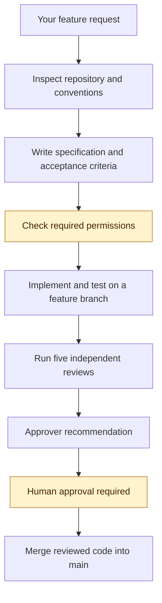
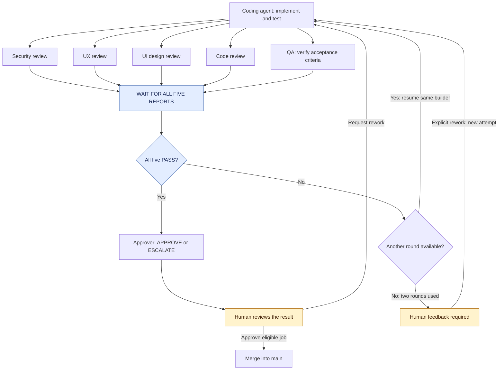
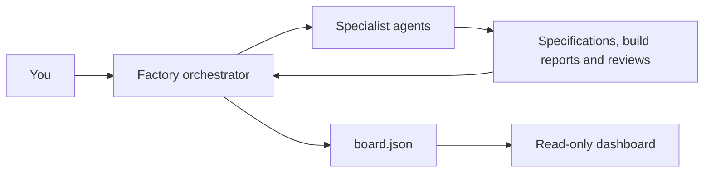
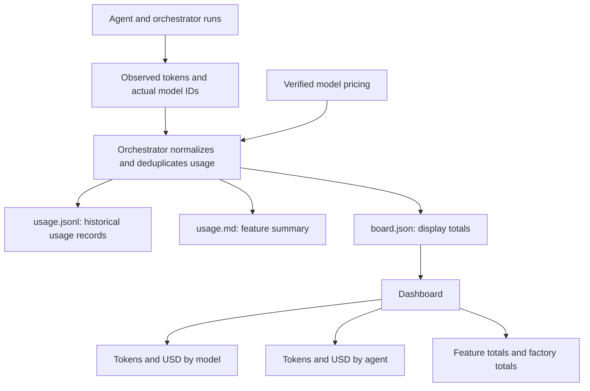

# Software Factory

A reusable generation prompt for building a small, visual software factory in your own project using Claude Code or local Codex.

## What it generates

- An orchestrator skill and specialist agents.
- A coding agent and independent security, UX, UI, code, and QA reviews.
- A dashboard showing features, review results, and human approval states.
- Token usage and USD cost breakdowns by model, agent, and feature.
- Markdown specifications, build reports, reviews, and decisions.

## Get started

1. Open [the generation prompt](software-factory.md).
2. Copy its complete contents.
3. Open your target project in local Codex or Claude Code.
4. Paste the prompt and let the agent inspect your project and create the files.
5. Follow the generated `factory/README.md` to start the dashboard and run your first feature.

Use your own AI provider account.

## Check connections before features

Use the [repository startup guide](../README.md) to check installation and authentication, then explicitly authorize live checks using your configured models. Verify access and builder continuation from the same runtime and permission environment used by workers. Codex running the generator does not itself run Claude models.

The updated prompt requires bounded checks, actionable sanitized errors, readiness timestamps, and preserved failure history. Manual tests do not update the board; the existing orchestrator publishes fresh readiness and observable usage. See [troubleshooting](../docs/TROUBLESHOOTING.md) when external PowerShell works but factory workers fail.

## How a feature moves through the factory

The orchestrator first inspects your project, then coordinates every stage. It asks for additional permission before implementation when necessary. Completed features always require human approval before merging.

The review stage includes a rework loop, shown below.

## Reviews and rework

All five reviewers must finish before the builder receives feedback. A failed check returns to the same builder, with a maximum of two review rounds per attempt.

An agent’s `APPROVE` is a recommendation. Human approval is required, and failed mandatory reviews must be resolved before merging.

## Who controls the files?

The orchestrator is the only writer of `board.json`. Workers write their own reports; the builder also edits application code and tests on its feature branch.

The dashboard displays progress. Approval commands run in Claude Code or Codex.

## Token usage and USD costs

Usage is recorded after each agent run, including observable retries and rework. The dashboard shows totals by agent, actual model, review round, and feature.

Reporting depends on available runtime telemetry:

- **Measured:** token counts reported by the runtime.
- **Estimated:** API-equivalent cost calculated from recorded pricing.
- **Reported charges:** authoritative billing data, when available.
- **Partial or unavailable:** missing usage or pricing information.

Unknown usage is never displayed as zero. Estimated API-equivalent costs are not necessarily additional charges on a subscription.

## Commands after generation

| Action | Claude Code command |
|---|---|
| Start a feature | `/factory <feature>` |
| Run the next backlog item | `/factory next` |
| Approve an eligible job | `/factory approve <job-id>` |
| Request changes | `/factory rework <job-id> <note>` |

The generated instructions document the corresponding local Codex invocation.

## Contributing

Open an issue to suggest improvements, or submit a pull request updating the prompt and documentation.

## License

MIT. See [LICENSE](../LICENSE).
